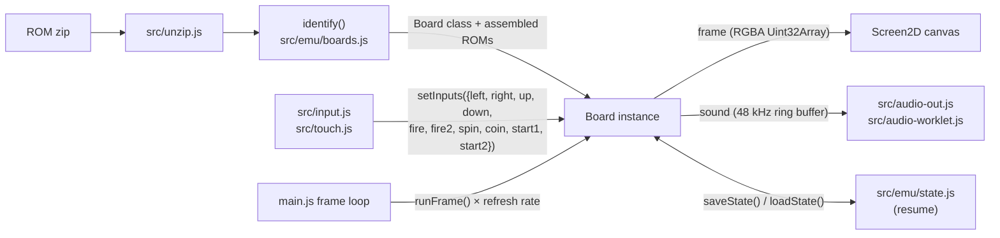
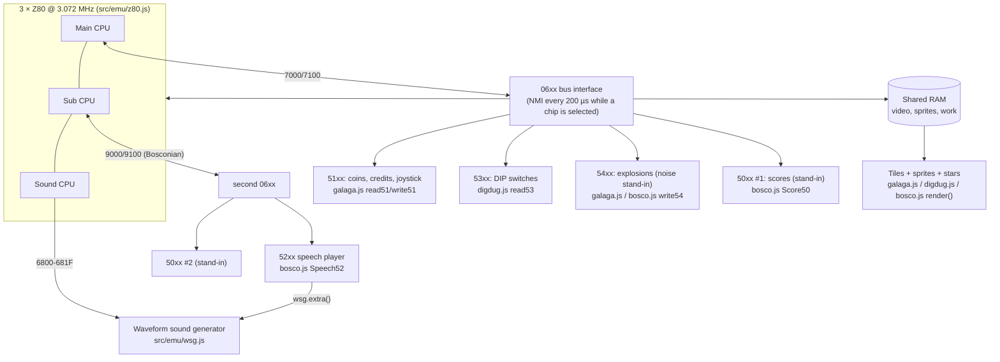
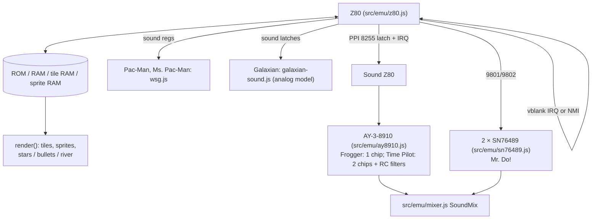
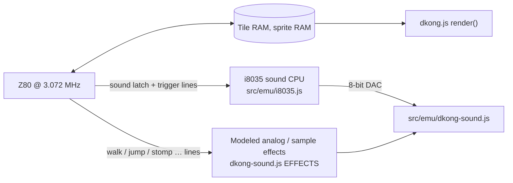
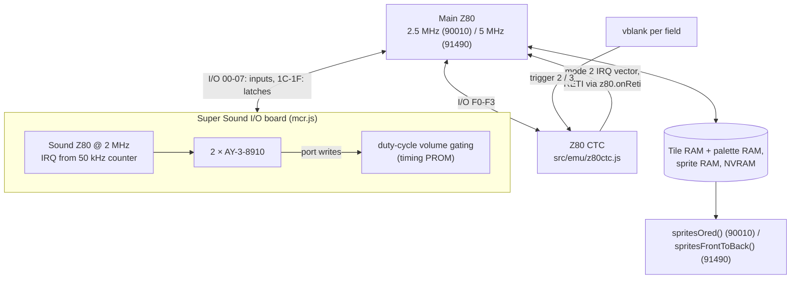
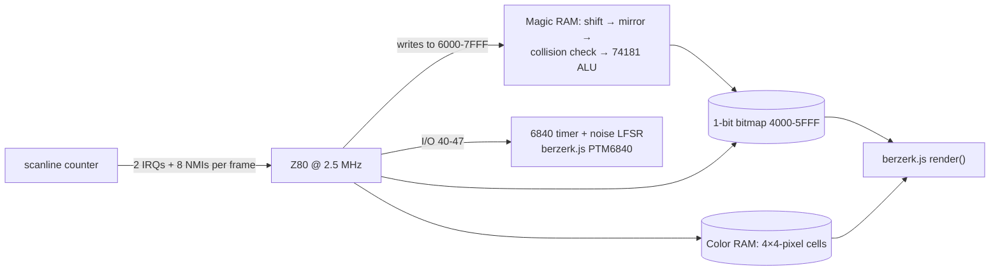

# z80js

A touch-first emulator for retro arcade games, for phones and desktop. Plain HTML, CSS and
JavaScript modules, with no dependencies and no build step. It shares its app shell (touch
controls, settings, game library, audio) with [6502js](https://github.com/madmonk13/6502js),
the Atari 2600 emulator it was forked from.

z80js started out as an emulator for Z80-based arcade boards only, and grew from there: it now
also runs boards built around the 6502, 6809, 68000, V30, ARM and other processors, from the
late 1970s into the 1990s. The name may change in a future rebrand.

**Play it:** [madmonk13.github.io/z80js](https://madmonk13.github.io/z80js/) · **195 games supported**

No ROMs are included: add your own ROM sets, the zips used by MAME. A set is recognized
by its chips' file names, so the zip's own name doesn't matter.

## Supported games

| Game | Board | MAME sets | Status |
|---|---|---|---|
| Galaga (1981) | Namco Galaga: 3 Z80s, custom I/O chips, waveform sound | `galagao` | **Tested:** boots, attract mode, coin, start and play |
| | | `galaga`, `galagamw`, `galagamk`, `galagamf`, `gallag` | Recognized, not yet tested |
| Pac-Man (1980) | Namco Pac-Man: 1 Z80, waveform sound | `pacman` (Midway) | **Tested:** boots, attract mode, coin, start and play |
| Galaxian (1979) | Namco Galaxian: 1 Z80, analog sound | `galaxian` | **Tested:** boots, attract mode, coin, start and play |
| Donkey Kong (1981) | Nintendo: Z80, an 8035 sound CPU with a DAC, analog effects | `dkong` (US set 1) | **Tested:** boots, attract mode, coin, start and play |
| Ms. Pac-Man (1981) | Pac-Man board plus Midway's add-on board (its ROMs are stored scrambled; z80js unscrambles them) | `mspacman` | **Tested:** boots, attract mode, coin, start and play |
| Frogger (1981) | Konami: Galaxian-style video, a second Z80 and an AY-3-8910 for sound | `frogger` | **Tested:** boots, attract mode, coin, start and play |
| Donkey Kong Jr. (1982) | Donkey Kong board with a second tile bank and different sound wiring | `dkongjr` (US) | **Tested:** boots, attract mode, coin, start and play |
| Dig Dug (1982) | Galaga board design plus a ROM-based background playfield, the 53xx switch reader and an EAROM | `digdug` (rev 2) | **Tested:** boots, attract mode, coin, start and play |
| | | `digdugb`, `digdugat` | Recognized, not yet tested |
| Time Pilot (1982) | Konami: 1 Z80, tiles and sprites re-used down the screen; a sound Z80 with two AY-3-8910s | `timeplt` | **Tested:** boots, attract mode, coin, start and play |
| | | `timepltc`, `timeplta` | Recognized, not yet tested |
| Bosconian (1981) | Galaga design plus two 06xx, two 50xx score chips, 52xx speech and a scrolling playfield with radar | `bosco` (new version) | **Tested:** boots, attract mode, coin, start and play, speech |
| Berzerk (1980) | Stern: 1 Z80, one-bit bitmap with "magic RAM" shifter/ALU and collision detection, 6840 sound effects | `berzerk` (set 1) | **Tested:** boots, attract mode, coin, start and play (no speech: see below) |
| | | `berzerk1` | Recognized, not yet tested |
| Frenzy (1982) | Berzerk board, bigger program | `frenzy` | **Tested:** boots, coin, start and play (no speech) |
| Pooyan (1982) | Konami: Time Pilot's sound board, 4-bit tiles and sprites | `pooyan` | **Tested:** boots, attract mode, coin, start and play |
| Scramble (1981) | Konami: Galaxian-style video, two AY-3-8910s, a protection check | `scramble` | **Tested:** boots, attract mode, coin, start and play |
| Amidar (1981) | Konami: as Scramble, different map and background color | `amidar` | **Tested:** boots, attract mode, coin, start and play |
| Moon Cresta (1980) | Nichibutsu: Galaxian board with graphics banking, encrypted program | `mooncrst` | **Tested:** boots, attract mode, coin, start and play |
| Jr. Pac-Man (1983) | Pac-Man board, encrypted program, scrolling 54-row playfield, banks | `jrpacman` | **Tested:** boots, attract mode, coin, start and play |
| Xevious (1982) | Galaga family: two scrolling tile layers, 3-bit sprites, terrain-map ROMs | `xevious` (Namco) | **Tested:** boots, attract mode, coin, start and play |
| Piranha (1981) | Pac-Man board, program and graphics with swapped lines | `piranha` | **Tested:** boots, coin, start and play |
| Crush Roller (1981) | Pac-Man board with a protection device | `crush` (Kural Samno) | **Tested:** boots, coin, start and play |
| Kick (1981) | Bally Midway MCR (90009 CPU board), dial | `kick` (upright) | **Tested:** boots, attract mode, coin, start and play |
| Rally-X (1980) | Namco: 1 Z80, waveform sound, scrolling playfield, radar panel | `rallyx` | **Tested:** boots, attract mode, coin, start and play |
| Warp & Warp (1981) | Namco: Intel 8080 (run on the Z80 core), 1-bit characters with 8-bit color, a hardware ball | `warpwarp` | **Tested:** boots, attract mode, coin, start and play |
| Mappy (1983) | Namco: two Motorola 6809s, 58xx I/O chips, 8-voice 15xx waveform sound, scrolling map | `mappy` (US) | **Tested:** boots, attract mode, coin, start and play |
| Centipede (1980) | Atari: MOS 6502, tiles and 8x16 sprites with palette RAM, POKEY sound, trackball | `centiped` (revision 3) | **Tested:** boots, attract mode, coin, start and play |
| Phoenix (1980) | Amstar: Intel 8085 (run on the Z80 core), two tile layers in banked video RAM, analog sound and a melody chip | `phoenix` (Amstar) | **Tested:** boots, attract mode, coin, start and play |
| Mr. Do! (1982) | Universal: 1 Z80, two tile layers (one scrolling), two SN76489s | `mrdo` | **Tested:** boots, attract mode, coin, start and play |
| | | `mrdot` | Recognized, not yet tested |
| Satan's Hollow (1981) | Bally Midway MCR (90010 CPU board): Z80 with a Z80 CTC, Super Sound I/O (Z80, two AY-3-8910s) | `shollow` | **Tested:** boots, attract mode, coin, start and play |
| | | `shollow2` | Recognized, not yet tested |
| Tron (1982) | MCR, as Satan's Hollow, plus the aiming dial | `tron` (set 1) | **Tested:** boots, attract mode, coin, start and play |
| Tapper (1983) | MCR (91490 CPU board): 5 MHz Z80, bigger sprites with their own palettes | `tapper` (Budweiser) | **Tested:** boots, attract mode, coin, start and play |
| Super Xevious (1984) | Xevious board, harder program | `sxevious` | **Tested:** boots, attract mode, coin, start and play |
| Puck Man (1980) | Namco's Japanese Pac-Man, program in eight 2K chips | `puckman` | **Tested:** boots, attract mode, coin, start and play |
| Pac-Man Plus (1982) | Pac-Man board, encrypted program (z80js decrypts it) | `pacplus` | **Tested:** boots, attract mode, coin, start and play |
| Super Cobra (1981) | Konami: Scramble board with a different map | `scobra` | **Tested:** boots, attract mode, coin, start and play |
| Space Invaders (1978) | Midway/Taito: Intel 8080 (run on the Z80 core), one-bit bitmap, barrel shifter, discrete sound, color overlay | `invaders` | **Tested:** boots, attract mode, coin, start and play |
| Lady Bug (1981) | Universal: 1 Z80, tiles, 8x8 and 16x16 sprites, two SN76489s, coin-triggered NMI | `ladybug` | **Tested:** boots, attract mode, coin, start and play |
| 1942 (1984) | Capcom: banked Z80, scrolling 16x16 background, stacked sprites, sound Z80 with two AY-3-8910s | `1942` | **Tested:** boots, attract mode, coin, start and play |
| Mr. Do's Castle (1983) | Universal: two Z80s talking through a latch, 4-bit tiles with priority, four SN76489s | `docastle` | **Tested:** boots, attract mode, coin, start and play |
| Popeye (1982) | Nintendo: encrypted Z80, 512x448 raster, background bitmap, protection shifter, AY-3-8910 | `popeye` (revision D) | **Tested:** boots, attract mode, coin, start and play |
| Pengo (1982) | Sega: Pac-Man video and sound, Sega-encrypted Z80, graphics and color banks | `pengo` (set 1) | **Tested:** boots, attract mode, coin, start and play |
| Bomb Jack (1984) | Tehkan: Z80, background pictures from a map ROM, 16x16 and 32x32 sprites, palette RAM, sound Z80 with three AY-3-8910s | `bombjack` | **Tested:** boots, self-test, attract mode, coin, start and play |
| Mario Bros. (1983) | Nintendo: Donkey Kong's design with a scrolling tile layer (the POW bump) and an 8039 driving a DAC | `mario` (MAME 2003 naming; `marioo` in newer MAME) | **Tested:** boots, attract mode, coin, start and play |
| Moon Patrol (1982) | Irem M52: Z80, three parallax backgrounds from ROM, a scrolling ground strip; sound board with a Motorola 6803, two AY-3-8910s and two MSM5205s | `mpatrol` | **Tested:** boots, attract mode, coin, start and play (jump and fire) |
| Joust (1982) | Williams: Motorola 6809, a 16-color bitmap drawn by the "special chip" blitter, 6821 PIAs, CMOS settings RAM; sound board with a 6808 and a DAC | `joust` (White/Green label) | **Tested:** boots, self-test, attract mode, coin, start and play |
| Robotron: 2084 (1982) | Same Williams board, twin joysticks | `robotron` (Solid Blue label) | **Tested:** boots, self-test, attract mode, coin, start and play (move and aimed fire) |
| Bubbles (1982) | Same Williams board, 8-bit CMOS | `bubbles` | **Tested:** boots, attract mode, coin, start and play |
| Splat! (1982) | Same Williams board, the second-generation blitter, twin sticks | `splat` | **Tested:** boots, attract mode, coin, start and play |
| Stargate (1981) | Williams board without the blitter | `stargate` | **Tested:** boots, attract mode, coin, start and play |
| Defender (1980) | The earlier Williams board: RAM to BFFF, an I/O page banked with ROM at C000 | `defender` (Red label) | **Tested:** boots, attract mode, coin, start and play |
| Sinistar (1982) | Williams board on its side, blitter clipping window, 49-position stick, HC-55516 CVSD speech | `sinistar` (revision 3) | **Tested:** boots, attract mode, coin, start and play, speech |
| Zaxxon (1982) | Sega: Z80, a ROM-map background sheared into the isometric view, 32x32 sprites, text layer; analog sound effects (synthesized here) | `zaxxon` (set 1) | **Tested:** boots, attract mode, coin, start and play |
| Ghosts'n Goblins (1985) | Capcom: Motorola 6809, scrolling 16x16 background split by priority, 4-bit sprites, text layer; sound Z80 with two YM2203s | `gng` (World set 1) | **Tested:** boots, attract mode, coin, start and play |
| Asteroids (1979) | Atari: 6502, Digital Vector Generator on a black-and-white vector monitor; analog sound effects (synthesized here) | `asteroid` (rev 2) | **Tested:** boots, attract mode, coin, start and play |
| Tempest (1981) | Atari: 6502, color Analog Vector Generator, math box, two POKEYs (sound and the spinner) | `tempest` (rev 3) | **Tested:** boots, attract mode, coin, start and play |
| Battlezone (1980) | Atari: 6502, Analog Vector Generator with the red/green overlay, math box, POKEY; analog sound (synthesized here) | `bzone` (rev 2) | **Tested:** boots, attract mode, coin, start and play |
| Star Wars (1983) | Atari: two 6809s, color Analog Vector Generator, matrix processor, four POKEYs and TMS5220 speech; analog yoke | `starwars` (rev 1) | **Tested:** boots, attract mode, coin, start and play, speech |
| Tail Gunner (1979) | Cinematronics: the Cinematronics CPU drawing on a vector monitor; analog stick; sound synthesized here | `tailg` | **Tested:** boots, attract mode, coin, start and play |
| New Rally-X (1981) | Namco: the Rally-X board with new code and graphics | `nrallyx` | **Tested:** boots, attract mode, coin, start and play |
| Dig Dug II (1985) | Namco: the Mappy board with a 56xx I/O chip | `digdug2` (new version) | **Tested:** boots, attract mode, coin, start and play |
| Motos (1985) | Namco: the Mappy board with two 56xx I/O chips | `motos` | **Tested:** boots, attract mode, coin, start and play |
| The Tower of Druaga (1984) | Namco: the Mappy board with a 56xx I/O chip, 64 sprite colors | `todruaga` (new version) | **Tested:** boots, attract mode, coin, start and play |
| Do! Run Run (1984) | Universal: the Mr. Do's Castle board, horizontal, memory rearranged | `dorunrun` (set 1) | **Tested:** boots, attract mode, coin, start and play |
| Mr. Do's Wild Ride (1984) | Universal: the Do! Run Run board | `dowild` | **Tested:** boots, attract mode, coin, start and play |
| Domino Man (1982) | Bally Midway MCR2: the Satan's Hollow / Tron board | `domino` | **Tested:** boots, attract mode, coin, start and play |
| Rush'n Attack / Green Beret (1985) | Konami: Z80, SN76489, a row-scrolled tile playfield with priority tiles, 48 double-buffered sprites | `rushatck` (US), `gberet` | **Tested:** boots, attract mode, coin, start and play |
| Mr. Goemon (1986) | Konami: the Green Beret board at 60 Hz, with banked ROM | `mrgoemon` (Japan) | **Tested:** boots, attract mode, coin, start and play |
| Sea Wolf II (1978) | Midway Astrocade: Z80, the Astrocade custom video chips; the discrete sound board is approximated | `seawolf2` | **Tested:** boots, attract mode, coin and start |
| Extra Bases (1980) | Midway Astrocade, trackball (moved with the stick) | `ebases` | **Tested:** boots, attract mode, coin, start and play |
| Space Zap (1980) | Midway Astrocade with the pattern board (blitter) | `spacezap` | **Tested:** boots, attract mode, coin, start and play |
| Wizard of Wor (1980) | Midway Astrocade: pattern board, two sound chips, sparkle and stars, Votrax speech (approximated) | `wow` | **Tested:** boots, attract mode with speech, coin, start and play |
| Gorf (1981) | Midway Astrocade like Wizard of Wor, on a vertical monitor | `gorf` | **Tested:** boots, attract mode with speech, coin, start and play |
| Robby Roto (1981) | Midway Astrocade like Wizard of Wor (no speech) | `robby` | **Tested:** boots, attract mode, coin, start and play |
| Forgotten Worlds (1988) | Capcom CPS-1: 68000, Z80, YM2151, OKI MSM6295; three tile layers, block sprites, starfield; rotary gun | `forgottn` (US) | **Tested:** boots, attract mode, coin, start and play |
| Ghouls'n Ghosts (1988) | Capcom CPS-1 (no OKI samples) | `ghouls` (World) | **Tested:** boots (its long self-test), attract mode, coin, start and play |
| Strider (1989) | Capcom CPS-1 with the starfield | `strider` (US) | **Tested:** boots, attract mode with sound, coin, start and play |
| Final Fight (1989) | Capcom CPS-1 | `ffight` (World) | **Tested:** boots, attract mode, coin, start and play |
| 1941: Counter Attack (1990) | Capcom CPS-1, vertical monitor | `1941` (World) | **Tested:** boots, attract mode, coin, start and play |
| Mercs (1990) | Capcom CPS-1, vertical monitor | `mercs` (World) | **Tested:** boots, attract mode, coin, start and play |
| Street Fighter II (1991) | Capcom CPS-1 at 12 MHz | `sf2` (World) | **Tested:** boots, attract mode, coin, start and play |
| Captain Commando (1991) | Capcom CPS-1 with the CPS-B-21's multiply protection | `captcomm` (World) | **Tested:** boots, attract mode, coin, start and play |
| Knights of the Round (1991) | Capcom CPS-1 with the CPS-B-21 | `knights` (World) | **Tested:** boots, attract mode, coin, start and play |
| Metal Slug (1996) | SNK Neo Geo MVS: 68000, Z80, YM2610 (FM, SSG, ADPCM-A/B), the LSPC's shrinking sprite strips and fix layer; boots through the MVS BIOS | `mslug` (a merged set: the zip must include the BIOS files, sp-s2.sp1, sfix.sfx and 000-lo.lo) | **Tested:** boots through the BIOS, attract mode, coin and start |
| Metal Slug 2 (1998) | SNK Neo Geo MVS (relies on the watchdog reset as a protection check) | `mslug2` | **Tested:** boots, title, coin and start |
| Metal Slug X (1999) | SNK Neo Geo MVS with its protection checks patched out | `mslugx` | **Tested:** boots, attract mode, coin and start |
| R-Type (1987) | Irem M72: NEC V30, Z80, YM2151; two tile layers with three priority levels, block sprites, a raster split for the status bar; the sound CPU runs from RAM the game loads | `rtype` (World) | **Tested:** boots, attract mode with sound, coin, start and play |
| Battle Chopper (1987) | Irem M72 with its protection MCU stood in for (see below) | `bchopper` | **Tested:** boots, attract mode with sound, coin, start and play |
| Ninja Spirit (1988) | Irem M72, MCU stood in for | `nspirit` | **Tested:** boots, attract mode with sound, coin, start and play |
| Image Fight (1988) | Irem M72, MCU stood in for; vertical monitor | `imgfight` (Japan) | **Tested:** boots, attract mode with sound, coin, start and play |
| Legend of Hero Tonma (1989) | Irem M72, MCU stood in for | `loht` | **Tested:** boots, attract mode with sound, coin, start and play |
| X Multiply (1989) | Irem M72 (its own memory map), MCU stood in for | `xmultipl` (Japan) | **Tested:** boots, attract mode with sound, coin, start and play |
| Dragon Breed (1989) | Irem M72 version, MCU stood in for | `dbreed` (M72 board set) | **Tested:** boots, attract mode with sound, coin, start and play |
| Air Duel (1990) | Irem M72, MCU stood in for; vertical monitor | `airduel` (Japan) | **Tested:** boots, attract mode with sound, coin, start and play |
| Gallop - Armed Police Unit (1991) | Irem M72 | `gallop` (Japan) | **Tested:** boots, attract mode with sound, coin and start |
| R-Type II (1989) | Irem M82: like M72, with ROM-based sound and a sample DAC | `rtype2` | **Tested:** boots, attract mode with sound, coin, start and play |
| Hammerin' Harry (1990) | Irem M82 | `hharry` (World) | **Tested:** boots, attract mode, coin, start and play |
| Major Title (1990) | Irem M84: a wider background with row scroll and a second sprite list | `majtitle` (Japan) | **Tested:** boots, attract mode, coin and start |
| The Legend of Kage (1984) | Taito: two Z80s, two YM2203s, and the 68705 MCU running its own (dumped) program; three tile layers | `lkage` | **Tested:** boots, attract mode with sound, coin, start and play |
| Shinobi (1987) | Sega System 16B: a 68000 behind the 315-5195 memory mapper, two scrolling tile layers with row/column scroll, a text layer, 128 sprites with shadow/highlight; a Z80 with a YM2151 and the uPD7759 speech chip ("Ninjutsu!"). Three fire buttons: attack, jump, magic | `shinobi` | **Tested:** boots, attract mode with music and speech, coin, start and play |
| Rolling Thunder (1986) | Namco System 86: two 6809s in lockstep, an HD63701 MCU running the sound (YM2151 and the CUS30 waveform chip), the 63701X voice player; four tile layers with priorities and sprites cut from 32x32 cells | `rthunder` | **Tested:** boots, attract mode with music and voices, coin, start and play |
| Wonder Momo (1987) | Namco System 86 with the ROM/voice expansion board, like Rolling Thunder | `wndrmomo` | **Tested:** boots, intro, coin, start and play with music and voices |
| Genpei ToumaDen (1986) | Namco System 86 with the expansion board (its main program runs partly from banked ROM) | `genpeitd` | **Tested:** boots, intro with music and voices, coin, start |
| The Return of Ishtar (1986) | Namco System 86; two sticks, one per character | `roishtar` | **Tested:** boots, attract, coin, start, name entry with music |
| Hopping Mappy (1986) | Namco System 86, no expansion board | `hopmappy` | **Tested:** boots, attract, coin, start and play with music |
| Sky Kid Deluxe (1986) | Namco System 86 with a banked program ROM | `skykiddx` | **Tested:** boots (its self-test restarts once on power-up), coin, start and play with music |
| Smash T.V. (1990) | Midway Y-unit: a TMS34010 graphics CPU, a DMA blitter drawing from 6-bit graphics ROMs into a 512x512 bitmap, 4096 colors; Williams CVSD sound board (6809, YM2151, DAC, HC55516 speech) | `smashtv` | **Tested:** boots through its self-test, attract mode, coin, start and play with music and speech |
| Total Carnage (1992) | Midway Y-unit with the Williams ADPCM sound board (6809, YM2151, DAC, OKI M6295) and the protection chip | `totcarn` | **Tested:** boots, intro, coin, start and play with music and samples |
| Mortal Kombat (1992) | Midway Y-unit (revision 4.0, the Y-unit board), ADPCM sound board and protection chip | `mkla4` | **Tested:** boots through the self-test, attract mode, coin, start, character select and fights with music and voices |
| Q*bert (1982) | Gottlieb System 80: Intel 8088 (on the V30 core), tiles and sprites, a 6502 sound board with a DAC and a Votrax SC-01 (approximated); vertical monitor | `qbert` | **Tested:** boots, attract mode with sound and speech, coin, start and play |
| Yie Ar Kung-Fu (1985) | Konami: 6809, SN76489, VLM5030 speech, a fixed tile map and 24 sprites | `yiear` | **Tested:** boots, attract mode with speech, coin, start and play |
| Silkworm (1988) | Tecmo: two Z80s, a YM3812 (FM, new core) and an MSM5205; three tile layers, sprites built from 8x8 cells with layer priorities | `silkworm` | **Tested:** boots, attract mode, coin, start and play (helicopter and jeep) |
| RoboCop (1988) | Data East MEC-M1: 68000, 6502 sound CPU with YM2203 + YM3812 + OKI M6295, three BAC06 playfields with row/column scroll, MXC06 sprites; a HuC6280 (new core) runs the protection program | `robocop` | **Tested:** boots, attract mode, coin, start and play |
| Aliens (1990) | Konami: the 052526 "Konami" CPU (new core), K052109 tilemaps, K051960 sprites, a Z80 with YM2151 and K007232 | `aliens` | **Tested:** boots, attract mode, coin, start and play |
| Ajax (1987) | Konami: Konami CPU plus a 6809 driving the K052109 and the K051316 rotate/zoom layer (3D stages), two K007232s and a YM2151; vertical monitor | `ajax` | **Tested:** boots, attract mode, coin, start and play |
| Crime Fighters (1989) | Konami: as Aliens, sprites between the layers | `crimfght` | **Tested:** boots, attract mode, coin, start and play |
| Super Contra (1988) | Konami: Konami CPU, K052109, K051960, K007232, YM2151; vertical monitor | `scontra` | **Tested:** boots, attract mode, coin, start and play |
| Gang Busters (1988) | Konami: Super Contra's board; vertical monitor | `gbusters` | **Tested:** boots, attract mode, coin, start and play |
| Bottom of the Ninth (1989) | Konami: 6809, K052109, K051960, K051316 (the field), two K007232s | `bottom9` | **Tested:** boots, attract mode, coin, start and play |
| Teenage Mutant Ninja Turtles (1989) | Konami: 68000 with the K052109/K051960 pair, YM2151, K007232, uPD7759 speech (master mode) and the recorded title music | `tmnt` | **Tested:** boots, attract mode, coin, start and play with music and speech |
| M.I.A. - Missing in Action (1989) | Konami: TMNT's board without the speech chip | `mia` | **Tested:** boots, attract mode, coin, start and play |
| Eyes (1982) | Pac-Man board, program with swapped data lines and swapped graphics lines | `eyes` | **Tested:** boots, attract mode, coin, start and play |
| Mr. TNT (1983) | Pac-Man board, scrambled like Eyes | `mrtnt` | **Tested:** boots, attract mode, coin, start and play |
| Lizard Wizard (1985) | Pac-Man board, 8-way stick | `lizwiz` | **Tested:** boots, attract mode, coin, start and play |
| Ponpoko (1982) | Sigma: Pac-Man board with rearranged graphics, active-high inputs; horizontal monitor | `ponpoko` | **Tested:** boots, attract mode, coin, start and play |
| Jump Shot (1985) | Pac-Man board, encrypted program | `jumpshot` | **Tested:** boots, attract mode, coin, start and play |
| Make Trax (1981) | Crush Roller's board and protection, as sold by Williams | `maketrax` | **Tested:** boots, attract mode, coin, start and play |
| Magic Brush (1981) | Crush Roller variant | `mbrush` | **Tested:** boots, attract mode, coin, start and play |
| Dream Shopper (1982) | Sanritsu: Pac-Man board with an AY-3-8910, a vblank NMI, more RAM and program | `dremshpr` | **Tested:** boots, attract mode, coin, start and play |
| Space Invaders Part II (1979) | Taito's color board: a color PROM per 8x8 block (one map per player), red screen flash | `invadpt2` | **Tested:** boots, attract mode, coin, start and play |
| Space Invaders (Color) (1979) | The original game on the color board | `sicv` | **Tested:** boots, attract mode, coin, start and play |
| Lunar Rescue (1979) | Taito color board; its own sound map (synthesized) | `lrescue` | **Tested:** boots, attract mode, coin, start and play |
| Galaxy Wars (1979) | Universal: Space Invaders board with the cellophane overlay | `galxwars` | **Tested:** boots, attract mode, coin, start and play |
| Ozma Wars (1979) | SNK: Space Invaders board, black and white; energy instead of lives | `ozmawars` | **Tested:** boots, attract mode, coin, start and play |
| Snap Jack (1982) | Universal: Lady Bug board | `snapjack` | **Tested:** boots, attract mode, coin, start and play |
| Cosmic Avenger (1981) | Universal: Lady Bug board, horizontal shooter with fire and bomb | `cavenger` | **Tested:** boots, attract mode, coin, start and play |
| Kick Rider (1984) | Universal: Do! Run Run board, two kick buttons | `kickridr` | **Tested:** boots, attract mode, coin, start and play |
| Colony 7 (1981) | Taito: Defender board, vertical monitor, three buttons | `colony7` | **Tested:** boots, attract mode, coin, start and play |
| Mayday (1980) | Defender board bootleg with a protection check | `mayday` | **Tested:** boots, attract mode, coin, start and play |
| Armored Car (1981) | Stern: Scramble board | `armorcar` | **Tested:** boots, attract mode, coin, start and play |
| Tazz-Mania (1982) | Stern: Scramble board, twin sticks | `tazmania` | **Tested:** boots, attract mode, coin, start and play |
| Anteater (1982) | Tago/Stern: Scramble board, scrambled graphics | `anteater` | **Tested:** boots, attract mode, coin, start and play |
| UniWar S (1980) | Irem: Galaxian board with a graphics bank latch | `uniwars` | **Tested:** boots, attract mode, coin, start and play |
| Pisces (1980) | Subelectro: Galaxian board with a graphics bank latch | `pisces` | **Tested:** boots, attract mode, coin, start and play |
| Black Hole (1981) | TDS: Galaxian board | `blkhole` | **Tested:** boots, attract mode, coin, start and play |
| Swarm (1979) | Subelectro: Galaxian board | `swarm` | **Tested:** boots, attract mode, coin, start and play |
| Defend the Terra Attack on the Red UFO (1981) | Galaxian board | `redufo` | **Tested:** boots, attract mode, coin, start and play |
| Moon Alien (1980) | Nichibutsu: Galaxian board | `moonaln` | **Tested:** boots, attract mode, coin, start and play |
| War of the Bugs (1981) | Armenia: Galaxian board, 8-way stick | `warofbug` | **Tested:** boots, attract mode, coin, start and play |
| Eagle (1980) | Centuri: Moon Cresta, unencrypted, new graphics | `eagle` | **Tested:** boots, attract mode, coin, start and play |
| Super Pac-Man (1982) | Namco Mappy board: 36x28 map, 2-bit sprites | `superpac` | **Tested:** boots, attract mode, coin, start and play |
| Pac & Pal (1983) | Namco Mappy board with the 56xx/59xx I/O chips | `pacnpal` | **Tested:** boots, attract mode, coin, start and play |
| Grobda (1984) | Namco Mappy board plus a DAC for speech | `grobda` | **Tested:** boots, attract mode, coin, start and play |
| Millipede (1982) | Atari: Centipede board grown up: two POKEYs, 32 colors, banked tiles, EAROM | `milliped` | **Tested:** boots, attract mode, coin, start and play |
| Warlords (1980) | Atari: Centipede board, four paddles on the POKEY's pot lines; the computer plays the empty castles | `warlords` | **Tested:** boots, attract mode, coin, start and play |
| Pleiads (1981) | Tehkan: Phoenix board with four palette banks, a protection bit and its own sound board (modeled) | `pleiads` | **Tested:** boots, attract mode, coin, start and play |
| Timber (1984) | Bally Midway MCR (91490, like Tapper), two chop buttons | `timber` | **Tested:** boots, attract mode, coin, start and play |
| Solar Fox (1981) | Bally Midway MCR (90009, like Kick) | `solarfox` | **Tested:** boots, attract mode, coin, start and play |
| Wacko (1982) | Bally Midway MCR (90010, like Tron): trackball and a firing stick | `wacko` | **Tested:** boots, attract mode, coin, start and play |
| Asteroids Deluxe (1981) | Atari: Asteroids board with a POKEY and an EAROM | `astdelux` | **Tested:** boots, attract mode, coin, start and play |
| Lunar Lander (1979) | Atari: Asteroids board, thrust lever | `llander` | **Tested:** boots, attract mode, coin, start and play |
| Red Baron (1980) | Atari: Battlezone board, flight stick, EAROM | `redbaron` | **Tested:** boots, attract mode, coin, start and play |
| Black Widow (1982) | Atari color vector board: AVG in 7 colors, two POKEYs, EAROM; twin sticks | `bwidow` | **Tested:** boots, attract mode, coin, start and play |
| Gravitar (1982) | Atari color vector board; thrust and shield/tractor buttons | `gravitar` | **Tested:** boots, attract mode, coin, start and play |
| Space Duel (1980) | Atari color vector board, 45 Hz picture | `spacduel` | **Tested:** boots, attract mode, coin, start and play |
| Star Castle (1980) | Cinematronics CPU (like Tail Gunner), 8K program; sound synthesized | `starcas` | **Tested:** boots, attract mode, coin, start and play |
| Rip Off (1980) | Cinematronics, 8K program; sound synthesized | `ripoff` | **Tested:** boots, attract mode, coin, start and play |
| Armor Attack (1980) | Cinematronics, 16K program; sound synthesized (the buildings were an overlay on the glass, not drawn) | `armora` | **Tested:** boots, attract mode, coin, start and play |
| Solar Quest (1981) | Cinematronics, 16K program, 64 intensity levels; sound synthesized | `solarq` | **Tested:** boots, attract mode, coin, start and play |
| Mad Planets (1983) | Gottlieb System 80, dial | `mplanets` | **Tested:** boots, attract mode, coin, start and play |
| Krull (1983) | Gottlieb System 80, twin sticks, tiles in RAM | `krull` | **Tested:** boots, attract mode, coin, start and play |
| Q*bert's Qubes (1983) | Gottlieb System 80, sprite bank | `qbertqub` | **Tested:** boots, attract mode, coin, start and play |
| Altered Beast (1988) | Sega System 16B (171-5521 board): punch, kick, jump | `altbeast` | **Tested:** boots, attract mode, coin, start and play |
| Golden Axe (1989) | Sega System 16B (171-5797 board) with the multiplier and timer chips; the 8751 MCU is simulated | `goldnaxa` | **Tested:** boots, attract mode, coin, start and play |
| Heavy Barrel (1987) | Data East 8-bit-era 68000 board (dec0) with rotary joystick and protection MCU (simulated) | `hbarrel` | **Tested:** boots, attract mode, coin, start and play |
| Tutankham (1982) | Konami: 6809, a 4bpp bitmap, Time Pilot sound board | `tutankhm` | **Tested:** boots, attract mode, coin, start and play |
| Juno First (1983) | Konami: Tutankham's board with an encrypted 6809 (Konami-1), a blitter, an 8039 DAC | `junofrst` | **Tested:** boots, attract mode, coin, start and play |
| Roc'n Rope (1983) | Konami: encrypted 6809 (Konami-1), Time Pilot sound board | `rocnrope` | **Tested:** boots, attract mode, coin, start and play |
| Shao-lin's Road (1985) | Konami: 6809, two SN76489s | `shaolins` | **Tested:** boots, attract mode, coin, start and play |
| NARC (1988) | Williams Z-unit: TMS34010, 8-bit graphics; a two-6809 sound board with YM2151, two DACs and CVSD speech | `narc` | **Tested:** boots, attract mode with music and speech, coin, start and play |
| Trog (1990) | Midway Y-unit (4-bit graphics); four players | `trog` | **Tested:** boots, attract mode, coin, start and play |
| Parodius Da! (1990) | Konami: 052001 CPU, K052109, K053245/K053251, YM2151, K053260 | `parodius` | **Tested:** boots, attract mode, coin, start and play |
| The Simpsons (1991) | Konami: 053248 CPU, K052109, K053247/K053251, YM2151, K053260, serial EEPROM; four players | `simpsons` | **Tested:** boots, attract mode, coin, start and play |
| Splatterhouse (1988) | Namco System 1: three 6809s behind a page MMU, HD63701 MCU, CUS30 + YM2151 + DAC | `splatter` | **Tested:** boots, attract mode, coin, start and play |
| Galaga '88 (1987) | Namco System 1, vertical monitor | `galaga88` | **Tested:** boots, attract mode, coin, start and play |
| Gauntlet (1985) | Atari: 68010 with the 104 Slapstic, motion objects, a 6502 with YM2151, POKEY and TMS5220 speech; four players | `gauntlet` | **Tested:** boots, attract mode, coin, start and play with music and speech |
| Space Odyssey (1981) | Sega G-80 raster with the 315-0063 security chip and the background board | `spaceod` | **Tested:** boots, attract mode, coin, start and play (effects synthesized) |
| Pac-Mania (1987) | Namco System 1, vertical monitor | `pacmania` | **Tested:** boots, attract mode, coin, start and play |
| Time Pilot '84 (1984) | Konami: two 6809s (the second multiplexes the sprites line by line), a Z80 with three SN76489s | `tp84` | **Tested:** boots, attract mode, coin, start and play |
| BurgerTime (1982) | Data East: 6502 with opcode encryption that applies only after a memory write, a second 6502 with two AY-3-8910s | `btime` | **Tested:** boots, attract mode, coin, start and play |
| Gyruss (1983) | Konami: Z80, an opcode-encrypted 6809 multiplexing the sprites, a Z80 with five AY-3-8910s and an 8039 DAC | `gyruss` | **Tested:** boots, attract mode, coin, start and play |
| Qix (1981) | Taito: two 6809s (game and a 256x256 8-bit bitmap), 6821 PIAs, a 6802 playing samples through a DAC; battery-backed CMOS | `qix` | **Tested:** boots (runs the operator setup on first power-on), attract mode, coin, start and play |
| Salamander (1986) | Konami Nemesis: 68000 with all graphics uploaded into RAM, per-line and per-column scrolling, zoomable sprites; Z80 with YM2151, K007232 and VLM5030 speech | `salamand` | **Tested:** boots, attract mode with speech, coin, start and play |
| Blades of Steel (1987) | Konami: HD6309 (run on the 6809 core; the game uses no 6309-only instructions), K007342 tilemaps, K007420 sprites, K051733 protection; 6809 with YM2203 and uPD7759 speech | `bladstle` (version E, joystick) | **Tested:** boots, attract mode with speech, coin, start and play |
| Marvel Super Heroes (1995) | Capcom CPS-2: 68000 with its program decrypted at load (CPS-2's two Feistel networks), the CPS-1 video chips plus CPS-2 sprites and priorities, a Z80 with QSound, EEPROM settings | `msh` | **Tested:** boots, attract mode, coin, start and a match with music |
| Captain America and The Avengers (1991) | Data East 32-bit: ARM2 (new core), three playfields with row scroll and a raster interrupt, graphics decrypted at load (chip 56); HuC6280 with YM2151 and two OKI M6295s | `captaven` | **Tested:** boots, attract mode, coin, hero select, start and play with music and samples |

Galaga's older dumps that name the chips by board location (`04m_g01.bin` … `5n.bin`) are
recognized too; that's the tested Galaga set. Gallag's extra Z80 stood in for Namco's
custom chips, which z80js emulates directly, so that CPU's ROM is ignored.

Not supported: **Gatsbee** (Galaga hack with switchable graphics) and the many other
Galaxian-board clones and conversions, each of which changes the hardware a little.

## Controls

z80js is meant as a single-player experience, so the cabinets' 2-player start button has been left off
the screen (a keyboard's 2 still presses it). Games where the start buttons pick a character or side
keep that choice, behind the one Start button.

The touch layout follows the game:

- **Galaga, Galaxian:** the left half is a left/right pad, the right half is fire.
- **Donkey Kong, Donkey Kong Jr.:** the left half is a 4-way joystick, the right half is jump.
- **Bosconian, Berzerk, Frenzy:** the left half is an 8-way joystick, the right half is fire.
- **Scramble, Xevious:** an 8-way joystick; the right half's bottom fires and its top drops
  bombs (Scramble's Bomb, Xevious's Blaster).
- **Moon Cresta:** a left/right pad and fire. **Pooyan:** the stick moves Mama up and down;
  fire shoots. **Amidar:** a 4-way joystick and the jump button. **Jr. Pac-Man, Piranha, Crush Roller:** stick only. **Rally-X:** a 4-way stick;
  fire lays a smoke screen. **Warp & Warp:** 4-way stick and fire. **Mappy:** left/right,
  and the button opens and closes doors.
- **Centipede:** the stick rolls the trackball at a steady speed (Q/E or the mouse wheel
  also roll it sideways); fire on the right. **Phoenix:** left/right; the bottom of the right half
  fires and the top raises the shield.
- **Kick:** the right half is a left/right dial pad: tapping kicks, and pushing left or right
  moves the clown (further from where you touched turns the dial faster), as the cabinet's
  dial did. Left/right, Q/E or the mouse wheel also work.
- **Dig Dug:** the left half is a 4-way joystick, the right half is the pump.
- **Time Pilot:** the left half is an 8-way joystick, the right half is fire.
- **Mr. Do!, Tapper:** the left half is a 4-way joystick, the right half is fire (Mr. Do!'s
  power ball, Tapper's pour/serve).
- **Dig Dug II:** a 4-way stick; the bottom of the right half pumps, the top drills.
- **Motos:** an 8-way stick; the bottom of the right half pushes, the top jumps.
- **The Tower of Druaga**, **Do! Run Run**, **Mr. Do's Wild Ride:** a 4-way stick and one button.
- **Domino Man:** an 8-way stick; the button sets down a domino.
- **Rush'n Attack / Green Beret:** an 8-way stick; the bottom of the right half stabs, the top fires
  the weapon you've picked up. **Mr. Goemon:** the bottom attacks, the top jumps.
- **Sea Wolf II:** push left or right to swing the periscope; tap to fire.
- **Extra Bases:** the stick moves the trackball (pitching and fielding); the button swings.
- **CPS-1 games:** an 8-way stick with attack (bottom) and jump (top); Mercs' top button is the
  mega crash bomb, 1941's the loop. **Street Fighter II** has six buttons on the cabinet; here the
  bottom is a medium punch and the top a medium kick (special moves work at any strength).
  **Forgotten Worlds:** hold to fire, push left or right on the fire side to turn the gun.
- **Q*bert:** the cabinet's stick is mounted diagonally; push diagonally on the touch pad (up-right,
  up-left, down-left, down-right) to hop that way. Keyboard arrows give the stick's own four directions.
- **R-Type games:** the bottom of the fire side shoots (hold to charge the beam), the top launches
  and recalls the Force. **Hammerin' Harry:** swing at the bottom, jump on top.
- **Metal Slug games:** the fire side is split in three: the bottom shoots, the middle jumps, the
  top throws a grenade (keyboard Z / X / F; gamepad A / B / Y).
- **Shinobi:** three buttons like Metal Slug: the bottom attacks (shuriken, or the sword up close),
  the middle jumps (hold up or down with it to leap between levels), the top casts ninja magic.
- **Smash T.V. / Total Carnage:** twin sticks: the left side moves, and dragging on the right
  side shoots that way. In Total Carnage the Start button drops a bomb. Both want two coins
  (two credits) to start.
- **Mortal Kombat:** the fire side is split in three: the bottom punches (high punch), the middle
  kicks (high kick), the top blocks; down plus punch is an uppercut. It needs two credits, or turn
  on **Free play** in Game switches (Blood and Violence are switches too).
- **The Return of Ishtar:** twin sticks: the left side moves Gil, the right side moves Ki. Ki's
  magic and Gil's sword are on keyboard / gamepad buttons (Z, X; A, B); touch has no room for them.
- **Hopping Mappy:** one button, jump. **Sky Kid Deluxe:** fire, and the top button loops.
- **Genpei ToumaDen / Wonder Momo:** attack at the bottom, jump on top.
- **Rolling Thunder:** the bottom of the fire side shoots, the top jumps; hold up while jumping to
  leap to the balcony above (or down to drop below), and push up at a door to hide in it.
- **Yie Ar Kung-Fu:** an 8-way stick; the bottom of the right half punches, the top kicks.
- **Satan's Hollow:** the left half is a left/right pad; on the right half, the bottom
  fires and the top raises the shield.
- **Tron:** the left half is an 8-way joystick. The right half is the trigger *and* the
  aiming dial: holding fires, and pushing left or right turns the dial, faster the further
  you push (like 6502js's paddles).
- **Robotron: 2084, Splat!:** twin sticks. The left half moves; the right half is a second stick
  that fires in the direction you drag (keyboard: I/J/K/L; gamepad: the right stick).
- **Defender, Stargate:** an 8-way stick flies the ship: up/down as on the cabinet, and
  left/right means "fly that way" (z80js presses Reverse when the ship faces the other way,
  reading which way it faces from the game's RAM, then Thrust). The bottom of the right half
  fires, the top drops a smart bomb; H is hyperspace and V inviso (gamepad triggers).
- **Sinistar:** an 8-way stick (the cabinet's 49-position stick at its extremes); the bottom
  of the right half fires, the top throws a Sinibomb.
- **Zaxxon:** an 8-way stick, as the cabinet's flight stick (pull back to climb), and fire.
- **Ghosts'n Goblins:** an 8-way stick; the bottom of the right half throws, the top jumps.
- **Asteroids:** left/right rotate; the bottom of the right half fires, the top thrusts.
  Hyperspace is H on a keyboard or a gamepad trigger (not yet on touch).
- **Tempest:** the left half is a left/right pad that turns the spinner, faster the further
  you push (Q/E or the mouse wheel also turn it); the bottom of the right half fires, the
  top is the Superzapper.
- **Battlezone:** one stick drives both treads: up/down move, left/right turn on the spot,
  diagonals turn with one tread. Tap the right half to fire.
- **Star Wars** and **Tail Gunner:** the stick is analog: on touch, how far the finger is
  from where it landed sets the yoke (up aims up); a gamepad's left stick works the same.
  Arrow keys steer it too, springing back to center. Tail Gunner's second button is the shield.
- **Joust:** left/right, and fire flaps. **Bubbles:** an 8-way stick only.
- **Bomb Jack:** 8-way stick, fire jumps. **Mario Bros.:** left/right, fire jumps. **Moon Patrol:** left/right
  slows and speeds the buggy; the bottom of the right half fires, the top jumps.
- **Pac-Man, Ms. Pac-Man, Puck Man, Pac-Man Plus, Lady Bug, Frogger:** no fire button, so the whole lower screen is a 4-way joystick.
- **Space Invaders:** a left/right pad and fire. **1942:** an 8-way joystick; the bottom of
  the right half fires and the top loops. **Mr. Do's Castle:** 4-way stick, fire swings the
  hammer. **Popeye:** 4-way stick, fire punches. **Pengo:** 4-way stick, fire pushes ice.
  **Super Cobra:** as Scramble.
- **Millipede:** as Centipede. **Warlords:** you're the bottom-left castle; drag the dial pad (or push
  left/right) to slide your shield, and the button catches the fireball. Press it during the join
  countdown to take your castle; the computer plays the rest.
- **Pleiads:** left/right; fire at the bottom, warp on top. **Space Invaders Part II, Lunar Rescue,
  Galaxy Wars, Ozma Wars:** left/right and fire.
- **Timber:** 4-way stick; the two buttons chop. **Solar Fox:** 4-way stick; fire at the bottom,
  speed on top (it also starts the game). **Wacko:** twin sticks: the left rolls the trackball, the
  right shoots that way.
- **Star Castle, Rip Off, Armor Attack:** left/right rotate, fire at the bottom, thrust on top.
  **Solar Quest:** the same plus hyperspace (third button); the nova bomb is 2-player Start.
- **Kick Rider:** 8-way stick, two kick buttons. **Eagle:** as Moon Cresta. **Dream Shopper:** 4-way
  stick and fire.
- **Colony 7:** 8-way stick; fire, bomb and shield. **Mayday:** 8-way stick (left fires behind);
  fire, Mayday bomb, back fire.
- **Silkworm:** Start offers **Heli** and **Jeep**: the one you pick chooses your
  vehicle (as on the cabinet, where player 1 flies the helicopter and player 2 drives the jeep). Fire at
  the bottom of the right half; the top makes the jeep jump.
- **RoboCop:** 8-way stick; fire at the bottom, jump on top.
- **Konami games:** **Aliens, Crime Fighters, Super Contra, TMNT:** attack/fire at the bottom, jump on
  top. **Ajax:** fire, missile and super weapon (three buttons). **Gang Busters:** the stick moves the
  sight; shoot and grenade. **Bottom of the Ninth:** the stick and two buttons (swing/pitch, run/throw).
  **M.I.A.:** fire, weapon, knife. Crime Fighters and TMNT start a player from their coin slot (Coin or
  Start both work).
- **Time Pilot '84:** 8-way stick; fire at the bottom, missile on top. **Gyruss:** 8-way stick (it moves the ship around
  the ring) and fire. **BurgerTime:** 4-way stick, the button throws pepper. **Pac-Mania:** the stick and jump.
- **Qix:** 4-way stick; the bottom button draws fast (blue), the top slow (red, worth double).
- **Salamander:** 8-way stick; fire at the bottom, missile on top. **Blades of Steel:** 8-way stick; shoot at the
  bottom, pass in the middle, check on top.
- **Marvel Super Heroes:** 8-way stick; the bottom of the right half is medium punch, the middle medium
  kick, the top heavy punch (the other three of the six buttons aren't on screen).
- **Captain America and The Avengers:** 8-way stick; attack at the bottom, jump on top. After starting, pick
  your hero (Captain America, Hawkeye, Iron Man or Vision) with the stick and press attack.
- **Four-player games** (TMNT, Trog, The Simpsons, Gauntlet): Start opens a choice of character
  (Leo/Mike/Don/Raph, Red/Blue/Yellow/Pink, Marge/Homer/Bart/Lisa, Warrior/Valkyrie/Wizard/Elf);
  picking one starts as that character and closes the choice (keyboard 1-4 pick directly). Where each
  character has a coin slot of their own (TMNT, Simpsons, Gauntlet), picking a character drops a coin in
  their slot and starts them, so there's no Coin button. Gauntlet has no start buttons on the cabinet:
  Magic doubles as start.
- **Heavy Barrel:** the rotary stick aims by itself toward the direction you push; fire at the bottom,
  grenade on top. **Tutankham:** fire shoots left or right (the way you last moved); the top button is
  the flash bomb. **Altered Beast:** punch, kick, jump. **Golden Axe:** attack, jump, magic. **NARC:** fire,
  jump, rocket. **Galaga '88:** fire. **Splatterhouse:** attack, jump. **Juno First, Space Odyssey:** fire (Juno First adds warp, Space Odyssey a bomb).
- **Coin / Start** sit in the top bar. Drop a coin, then press Start. A game started from power-on
  (not resumed from where you left it) shows a **Booting** card with its name for a few seconds, and
  the pause card names the game too.
- Keyboards and gamepads also work: arrows or WASD to move, Space/Z to fire, X or Shift
  for a second button (fire in one-button games), F for a third, Q/E or the mouse wheel (or the
  gamepad's shoulder buttons) to turn a dial, 5 or C for a coin, 1 or Return to start
  (2 for two players).
- **Left-handed** mode in settings swaps the halves.
- **Show control zones** (settings, on by default): a faint outline of each control's area
  with its name (Move, Fire, and the second button such as Blaster or Shield, which takes
  the top half of the fire side). **Zone opacity** sets how faint. When a game loads the zones
  show at full strength on a dark backing, and the first touch (or key / gamepad press) fades
  them to that opacity. Pausing brings them back up; resuming fades them down again. The older **touch hints** cards are still in settings, off by default.
- **Zone overlap** (settings, 0-100%, 25% by default): the control zones keep mostly clear
  of the picture, reaching over it by this much: up from the band below it in portrait (a
  share of its height), in from the side margins in landscape (a share of the way to its
  middle). 0% keeps them off the picture entirely; 100% covers the whole screen. Touches
  outside the zones still count by side (stick on one, plain fire on the other).
- **Three-button games** (Metal Slug) split the fire side's zone in thirds: fire at the bottom, the
  second button in the middle, the third on top. The move side is unchanged.
- **Two-button games:** the second button is the upper half of the fire side's zone, Fire
  the lower half. In portrait the picture is a little smaller to leave room for both.
- **Pause** (the ⏸ button in the top bar, or P on a keyboard): stops the game and its sound; tap
  the screen or the button again to resume. The game is saved for resume when paused, and
  after a reload the game comes back paused, so play starts when you're ready.

## Settings (⚙) and Games

- **Games:** every supported game, in alphabetical order. Games you haven't added a ROM
  set for are greyed out and name the zip they expect ("Upload invaders.zip to enable"); turn off
  **Show all supported ROMs** to list only the games you've added. Tap one, or **Add ROM set…**, to add
  its zip. Sets are kept whole in the browser's IndexedDB (large sets like Metal Slug X run to
  30 MB; the app asks for persistent storage so the browser keeps them), and the last game played starts on launch.
- **Sets served beside the app:** when z80js is served from a folder that also holds ROM sets in a
  `roms/` folder with a browsable listing (for example `npm start` in this repo), the Games list shows
  those sets too ("On the server · tmnt.zip") and plays them straight from the server. Each one has a
  **↓** button that saves a copy to the device for offline play; once saved, the same button becomes
  **✕**, which removes the device copy (the game stays playable from the server). Files are matched to
  games by their MAME set name (or by what loading one reveals). Saves, high scores and switches are
  kept on the device either way and are shared between the server and device copies of a set.
- **Controls, Sound and volume**, as in 6502js.
- **Resume where I left off** (on by default): the game in progress is saved whenever play
  stops (pause, opening a menu, switching games, or the page being hidden or closed, as when you
  switch apps or lock the phone), so a refresh or relaunch picks up exactly where you were. It
  isn't saved during play, so a crash loses what happened since the last stop. Restart / Power
  cycle starts over.
- **Battery RAM:** boards with battery-backed settings and high scores (the Midway Y-unit
  games' CMOS) keep it per ROM set, so the first launch's "factory settings restored"
  message (press any button) appears only once.
- **Game switches:** each game's own DIP switches (lives, bonus life, difficulty and so
  on), remembered per game. Like the real boards, games read them at power-on, so they
  apply when you tap **Restart game**.

Settings and Games open full screen; the game pauses while either is open.

## Offline and install

The app is a PWA: open it once while online and a service worker (`sw.js`) caches it, so it then
starts and plays without a network, from the browser or installed to the home screen ("Add to Home
Screen" on iOS, "Install app" in Chrome). Games kept on the device stay available offline; ROM sets
streamed from a server's `roms/` folder need that server. When online it always loads the current
version from the network first, and the cache follows.

Service workers only run on **https** or **localhost**: serving the folder over plain http to a
phone on the LAN works, but without offline support. `sw.js` is generated: `npm start` rebuilds it,
or run `npm run sw` after changing files, and commit it with them.

## Run

```bash
npm start     # http://localhost:1976
```

Headless check (boots a set and saves the screen as a PNG):

```bash
node tools/run-board.mjs path/to/set.zip 1500 out/frame.png
```

`node tools/state-check.mjs [set ...]` checks that saved games restore exactly;
`node tools/sound-check.mjs path/to/set.zip` prints sound levels. `COIN=600 START=700` in the environment drops a coin and starts a game; `HOLD=left` (or
right, up, down, fire) then holds a control.

## Layout

- `src/emu/z80.js`: the Z80 CPU (full instruction set including the undocumented parts,
  T-state timing, IM 0/1/2, NMI, HALT).
- `src/emu/boards.js`: the supported boards, how each ROM set is recognized, and the
  interface every board implements.
- `src/emu/galaga.js`: three Z80s on a shared bus, control latches and interrupts, the
  06xx bus interface, a high-level 51xx (coins, credits, controls), tiles, 64 sprites and
  the starfield (`galaga-stars.js`).
- `src/emu/pacman.js`: tiles, 8 sprites, IM 2 interrupts; Ms. Pac-Man's add-on board
  (unscrambling its ROMs and patching the Pac-Man program).
- `src/emu/galaxian.js`: column-scrolled tiles, sprites, hardware bullets and the star
  generator; `galaxian-sound.js` models its analog sound board.
- `src/emu/dkong.js`: Donkey Kong and Donkey Kong Jr.: tiles (colored per column and
  4-row block), 96 sprites and the interface to the sound CPU; `dkong-sound.js` is the DAC and analog effects.
- `src/emu/i8035.js`: the Intel 8035/8039 (MCS-48) microcontroller, Donkey Kong's sound CPU.
- `src/emu/frogger.js`: Frogger, built on the Galaxian board: its river background,
  rewired color and position lines, the 8255 PPI interface, and the sound board's Z80.
- `src/emu/digdug.js`: Dig Dug, built on the Galaga board: the background playfield
  (four pictures in a map ROM), the 1-bit text layer, its sprites and the 53xx.
- `src/emu/timeplt.js`: Time Pilot: tiles with priority, sprites latched line by line (the
  game re-uses them down the screen for its clouds) and the two-AY sound board with its
  switchable filters.
- `src/emu/bosco.js`: Bosconian, built on the Galaga board: the second 06xx, stand-ins
  for the 50xx score chips and the 54xx, the 52xx speech player, the playfield, radar
  panel and dots, and the two-way starfield.
- `src/emu/berzerk.js`: Berzerk: the bitmap, the magic-RAM shifter and ALU with collision
  detection, scanline-timed interrupts, and the 6840 sound effects.
- `src/emu/scramble.js`: Scramble and Amidar, built on Frogger (two-AY sound board).
- `src/emu/galaxian.js` also holds Moon Cresta (decryption, graphics banks); `pacman.js`
  holds Jr. Pac-Man (decryption, scrolling playfield, banks); `timeplt.js` holds Pooyan;
  `berzerk.js` holds Frenzy; `bosco.js` holds Xevious (tile layers, sprites, terrain reader).
- `src/emu/rallyx.js`: Rally-X. `src/emu/warpwarp.js`: Warp & Warp and its sound circuit.
- `src/emu/m6809.js`: the Motorola 6809 CPU (documented instruction set, indexed
  addressing, NMI/FIRQ/IRQ).
- `src/emu/mappy.js`: Mappy: two 6809s, the 58xx I/O chips, the 15xx sound, the
  scrolling map and sprites. The same design runs Super Pac-Man, Pac & Pal, Dig Dug II,
  Motos, The Tower of Druaga, Grobda and Phozon.
- `src/emu/m6502.js`: the MOS 6502, shared with 6502js, plus IRQ/NMI.
- `src/emu/pokey.js`: Atari's POKEY sound chip (dividers, polynomial distortion, joined
  16-bit channels, high-pass, the random register).
- `src/emu/centiped.js`: Centipede. `src/emu/phoenix.js`: Phoenix and its sound.
- `src/emu/mrdo.js`: Mr. Do!: two tile layers, sprites, and its protection read.
- `src/emu/mcr.js`: the Bally Midway MCR boards (Satan's Hollow, Tron, Tapper): tiles,
  both sprite generators, palette RAM, and the Super Sound I/O board (its sound Z80, two
  AYs gated by duty-cycle counters, and the game's input ports).
- `src/emu/z80ctc.js`: the Zilog Z80 CTC counter/timer, with mode 2 interrupts and RETI.
- `src/emu/ay8910.js`: the General Instrument AY-3-8910 sound chip (with optional
  per-channel low-pass filters and volume gating).
- `src/emu/sn76489.js`: the Texas Instruments SN76489 sound chip (Mr. Do!, Lady Bug, Mr. Do's Castle).
- `src/emu/invaders.js`: Space Invaders: the bitmap, the MB14241 shifter, the two
  interrupts, the color overlay and a synthesized model of its sound effects.
- `src/emu/ladybug.js`: Lady Bug. `src/emu/docastle.js`: Mr. Do's Castle (the two CPUs'
  latch handshake, tile priority, the sprite mask pen).
- `src/emu/c1942.js`: 1942. `src/emu/popeye.js`: Popeye (decryption, background bitmap,
  protection). `src/emu/pengo.js`: Pengo (Sega decryption, on the Pac-Man board code).
  `pacman.js` also holds Puck Man and Pac-Man Plus (decryption); `scramble.js` Super Cobra;
  `bosco.js` Super Xevious.
- `src/emu/mpatrol.js`: Moon Patrol and Irem's sound board; `src/emu/m6803.js` is the
  Motorola 6803 (6800 instructions plus the 6801 additions, internal RAM, ports and
  timer); `src/emu/msm5205.js` the OKI ADPCM decoder.
- `src/emu/williams.js`: the Williams board (Joust, Robotron): bitmap, blitter, ROM/RAM
  banking, CMOS, the video-counter interrupts and the 6808 sound board;
  `src/emu/pia6821.js` is the Motorola 6821 PIA. The 6808 runs on the 6803 core with its
  on-chip parts switched off.
- `src/emu/hc55516.js`: the Harris HC-55516 CVSD speech decoder (Sinistar).
- `src/emu/zaxxon.js`: Zaxxon. `src/emu/gng.js`: Ghosts'n Goblins; `src/emu/ym2203.js` is the
  Yamaha YM2203 (three 4-operator FM channels plus the SSG, on the AY-3-8910 core).
- `src/emu/asteroids.js`: Asteroids; `src/emu/dvg.js` is Atari's Digital Vector Generator.
- `src/emu/tempest.js`: Tempest. `src/emu/bzone.js`: Battlezone. `src/emu/avg.js` is Atari's
  Analog Vector Generator (per instruction), `src/emu/mathbox.js` the math box for both.
- `src/emu/starwars.js`: Star Wars (including the matrix processor, which runs the
  microcode in the set's PROMs); `src/emu/tms5220.js` is the TI TMS5220 speech chip and `src/emu/vlm5030.js` the Sanyo VLM5030 (Yie Ar Kung-Fu). `src/emu/m68000.js` is a Motorola 68000 core (CPS-1, Neo Geo); `src/emu/m6805.js` is a 68705 MCU core (Legend of Kage); `src/emu/segas16b.js` is Sega System 16B and `src/emu/upd7759.js` its uPD7759 ADPCM speech chip (slave mode); `src/emu/tms34010.js` is a TI TMS34010 graphics CPU core (bit-addressed fields, the X,Y instructions, PIXT, FILL and PIXBLT, the video timing and display interrupt) and `src/emu/midyunit.js` the Midway Y-unit board with its DMA blitter and the Williams CVSD and ADPCM sound boards; `src/emu/namcos86.js` is Namco System 86 and `src/emu/cus30.js` its CUS30 waveform chip (the HD63701 MCU runs on the 6803 core, which has its extra instructions); `src/emu/v30.js` is a NEC V30 (8086/80186 plus NEC's extensions) for the Irem boards. Most M72 games have an 8751 protection MCU whose program was never read out; `src/emu/m72.js` stands in for its start-up routine (leaving the bytes the games check for and jumping to their entry points) and supplies their sample start addresses; `src/emu/ym2610.js` is the Neo Geo's YM2610; `src/emu/ym2151.js` and `src/emu/okim6295.js` are the YM2151 FM chip and OKI ADPCM sample player. `src/emu/votrax.js` approximates the Votrax SC-01 (Gorf, Wizard of Wor) by formant synthesis: the vowel, glide and nasal formants and levels were measured from recordings of the real chip, its phoneme timings are the datasheet's, and the voice runs at the chip's measured 120 Hz.
- `src/emu/tailg.js`: Tail Gunner; `src/emu/ccpu.js` is the Cinematronics CPU.
  `src/render/vector.js` draws vector games' display lists at the screen's own resolution,
  with a soft phosphor glow.
- `src/emu/mixer.js`: mixes a board's sound chips into one output.
- `src/emu/wsg.js`: Namco's 3-voice waveform sound generator (Pac-Man, Galaga, Dig Dug).
- `src/emu/video.js`: graphics decoding, PROM palettes and rotation for vertical monitors.
- `src/main.js`, `src/touch.js`, `src/input.js`, `src/audio-out.js`: the app shell.

## How the boards are simulated

Every board is a JavaScript class with the same interface (see the top of
`src/emu/boards.js`). The app shell knows nothing about any particular board:



Inside `runFrame()`, each board steps its CPUs a scanline (or a slice of one)
at a time, fires interrupts at the lines the hardware does, calls its sound
chips' `sample()` so they fill exactly 48,000 samples per emulated second, and
renders the picture once per frame (rotated with `rotate90`/`rotate270` in
`src/emu/video.js` for vertical monitors).

### Namco Galaga family: Galaga, Dig Dug, Bosconian



Files: `src/emu/galaga.js` (base class), `src/emu/digdug.js`, `src/emu/bosco.js`,
`src/emu/galaga-stars.js`, `src/emu/wsg.js`.

### Pac-Man / Galaxian / Frogger / Mr. Do! / Time Pilot: one main Z80



Files: `src/emu/pacman.js` (Pac-Man, Ms. Pac-Man add-on decryption),
`src/emu/galaxian.js` → `src/emu/frogger.js` (subclass), `src/emu/timeplt.js`
(sprites latched per scanline for the cloud multiplexing), `src/emu/mrdo.js`.

### Nintendo Donkey Kong / Donkey Kong Jr.



### Bally Midway MCR: Satan's Hollow, Tron, Tapper



Files: `src/emu/mcr.js` (base class `MCR`, subclasses `SatansHollow`, `Tron`,
`Tapper`), `src/emu/z80ctc.js`, `src/emu/ay8910.js`, `src/emu/mixer.js`.

### Stern Berzerk



## Known gaps

- **Marvel Super Heroes** needs about 100 MB of memory once its graphics are unpacked; its raster effects
  (the lava level) are approximate, the QSound positioning is reduced to mono, and only three of its six
  buttons are on screen.
- **Qix** keeps its settings in battery-backed CMOS. On the very first power-on (no saved CMOS) the board shows the
  operator's setup pages; z80js steps through them with the factory settings, which takes about eight seconds.
- **Blades of Steel:** only the joystick version (`bladstle`) is supported; the trackball version (`bladestl`) isn't.
- **Space Odyssey's sound** is recorded samples on the cabinet, not in the ROM set; z80js synthesizes the effects.
- **Golden Axe and Heavy Barrel's MCUs** are simulated from what the games expect, not run from their programs.
- **Parodius sequels** (Gokujyou, Jikkyou Oshaberi, Sexy Parodius) are on Konami GX (68020) hardware, not yet supported.
- **Galaga explosions:** the 54xx sound chip runs its own program, which isn't part of the
  game ROMs, so a short burst of noise stands in.
- **Galaga starfield:** generated by z80js, not the arcade's exact star pattern.
- **Galaxian sound**, **Donkey Kong's walk, jump and stomp** and **Donkey Kong Jr.'s
  climb, jump, land, roar, snapjaw, death and drop** effects are models (of analog
  circuits, or of recorded samples on the original), so they're close but not exact. Donkey Kong's music is the real thing:
  its own sound CPU program, run by the 8035 core.
- **Dig Dug** ignores coins for its first ~11 seconds, while its power-on self test
  runs. Its high scores live in an EAROM that's kept only while running.
- **Bosconian's 50xx and 54xx** are microcontrollers whose programs aren't in the ROM set:
  the 50xx is reimplemented from its documented commands (scores, bonus and high-score
  checks), and the 54xx's shots and explosions are bursts of noise. Like Dig Dug, it
  ignores coins during its ~16-second power-on test.
- **Berzerk's robot voice** lives on a separate speech board whose two ROMs (`1c`, `2c`)
  many Berzerk sets don't include; the speech chip isn't emulated yet, so the robots are
  silent. The 6840 sound effects play.
- **Crush Roller's protection** is handled as MAME does for this set: fixed answers to its
  checks and a few instructions patched in the instruction stream only.
- **Mappy's I/O chips** answer their power-on check with the documented result for
  Mappy's own query; other games in the family send different queries and will need
  theirs added.
- **Warp & Warp's sound** is modeled from the circuit's description (tones, noise and
  decays), so it's close but not exact.
- **Phoenix's sound** is modeled from its circuit descriptions; the melody chip's two tunes
  ("Für Elise" and "Romance de Amor") are transcribed by hand, and which tune number is
  which (besides the opening one) is a guess. **Centipede's trackball** moves at a fixed
  speed from the stick rather than following a real ball.
- **Scramble's protection** answers come from a table of the values the program checks for,
  as MAME does for this set; other Scramble sets may need different answers.
- **Xevious** uses the same 50xx/54xx stand-ins as Bosconian, and its explosion sounds are
  noise bursts. Sound filters on the Konami boards (Scramble, Amidar) aren't modeled.
- **Space Invaders' sound** is synthesized by ear (one small voice per effect) rather than
  modeled from the discrete circuits; the color overlay is approximate.
- **Mr. Do's Castle's third CPU** isn't run (the game doesn't depend on it), and the main
  CPU's wait on the latch is modeled by pausing it until the second CPU answers.
- **Mario Bros.' running, skid, ice and coin sounds** were analog circuits (MAME plays
  recordings of them); they're silent here. The music and other effects, from its 8039, play.
- **Bomb Jack** runs its power-on self test for about 20 seconds before the attract mode.
- **Joust and Robotron** keep their settings and high scores in battery-backed CMOS RAM,
  which starts blank in a new session: the game restores its factory settings and waits
  for the operator's Advance switch, which z80js presses for you. The CMOS is part of the
  saved game, so it persists with "Resume where I left off".
- **Zaxxon's sound** effects were analog circuits that MAME plays from recordings (not part of
  the ROM set); z80js synthesizes rough stand-ins for the engine, missiles, laser, explosions
  and alarms.
- **Ghosts'n Goblins' FM sound** is modeled from the YM2203's documented behavior (operators,
  algorithms, feedback, envelopes) rather than reproduced bit for bit, so instruments sound
  close but not identical; detune isn't applied.
- **Vector generators** are modeled per instruction: the real state-machine PROMs aren't in
  the ROM sets. Monitor effects (beam overshoot, Star Wars' flash when hit) aren't drawn.
- **Battlezone's** engine, shells and explosions and **Tail Gunner's** sounds were analog
  boards (MAME plays recordings that aren't in the sets); z80js synthesizes stand-ins.
- **Star Wars' speech** follows the TMS5220's documented synthesis (frames, interpolation,
  lattice filter), so the film's voices are recognizable but not bit-exact.
- **Asteroids' sound** came from analog circuits; z80js synthesizes stand-ins for the
  heartbeat, saucers, shots, thrust, explosions and extra-life tone.
- **Cinematronics sounds** (Star Castle, Rip Off, Armor Attack, Solar Quest) were analog boards
  MAME plays from recordings; z80js synthesizes stand-ins from the same triggers. Star Castle's
  colored ring overlay and Armor Attack's buildings (printed on the glass) aren't drawn.
- **Pleiads' sound** is modeled from the circuit description, whose part values are guesses.
  **Lunar Rescue's** sound is synthesized by ear like Space Invaders'.
- **YM3812 (OPL2):** modeled from its documented behavior like the other FM chips; the rhythm-mode
  drums are approximations. **HuC6280:** only RoboCop's protection program runs on it so far.
- **Konami's K051960 sprite shadows** darken by a fixed amount, and its zoom is nearest-pixel. Ajax's
  main CPU reads an unconnected address that returns random data on the real board (MAME does the
  same); z80js returns a pseudo-random value.
- Upright cabinets only (no cocktail flip); coinage is fixed at 1 coin, 1 credit.
